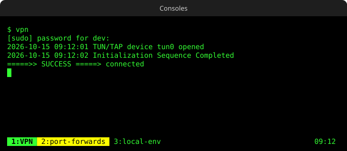

# retro-console

Desktop launchers for your long-running terminal commands (VPN, port-forwards, local
services, log tails...) that open as **tabs of a single 80s-style terminal window**,
green phosphor on black, instead of a pile of windows.



- **One window**: the first launcher opens it, the next ones add tabs.
- **Groups**: launchers with the same tab share it. Clicking *Start* or *Stop* of the same
  group stops whatever runs in that tab and runs the new command there.
- **Close the window to stop everything**: every command gets `SIGHUP`, as if its own
  terminal had been closed.
- **Activity highlight**: tabs with new output turn yellow.
- **Themes**: green, amber or white.
- Uses its **own tmux server and config**, so your tmux setup is never touched.

## Requirements

Linux with GNOME Terminal (Ubuntu, Fedora...), tmux and dconf. On Ubuntu:

```bash
sudo apt install tmux gnome-terminal dconf-cli
```

## Install

```bash
git clone https://github.com/victor-porcar/retro-console.git ~/.local/share/retro-console
~/.local/share/retro-console/install.sh
```

It links `retro-console` into `~/.local/bin`, writes a default config and creates the
"Retro Console" GNOME Terminal profile. To update: `git pull` and run `install.sh` again.

## Usage

Create launchers on your desktop; the ones with the same `--tab` form a group:

```bash
retro-console add "VPN"       --run "sudo openvpn --config ~/vpn/work.ovpn" --tab VPN --icon network-vpn
retro-console add "Kill VPN"  --run "sudo pkill openvpn"                    --tab VPN --icon network-vpn-disabled
retro-console add "Start DBs" --run "docker compose -f ~/dbs/compose.yaml up"   --tab DBs --icon media-playback-start
retro-console add "Stop DBs"  --run "docker compose -f ~/dbs/compose.yaml down" --tab DBs --icon media-playback-stop
```

Then just click them. The command runs in an interactive bash, so your aliases and
functions work, and the tab stays open when it ends so you can read the output.

| Command | Does |
|---|---|
| `retro-console add <name> --run <cmd> [--tab <tab>] [--icon <icon>]` | create a launcher (tab defaults to the name) |
| `retro-console list` | show your launchers |
| `retro-console remove <name>` | delete a launcher |
| `retro-console run <tab> <cmd>` | run a command in a tab without a launcher (scripts, keyboard shortcuts...) |
| `retro-console setup` | apply the config |

In the window: click a tab to switch to it, or use `Ctrl+b` then `n` / `p`. Close a
finished tab with `Enter`; close the window to stop everything.

Icons are names from your icon theme (`network-vpn`, `media-playback-start`,
`utilities-terminal`...) or a path to an image.

## Configuration

`~/.config/retro-console/config`, applied with `retro-console setup`:

```ini
title = Consoles             # window title
theme = green                # green | amber | white
font  = DejaVu Sans Mono 8
size  = 110x20               # columns x rows
```

## Writing commands that stop cleanly

Closing a tab or the window sends `SIGHUP` to its command. Most programs exit on it.
Some don't: OpenVPN, for instance, treats `SIGHUP` as "reconnect". For those, wrap the
command in a script that traps `HUP` and stops it properly:

```bash
#!/bin/bash
trap 'sudo pkill -TERM openvpn; exit' HUP INT TERM
sudo openvpn --config ~/vpn/work.ovpn &
wait
```

## How it works

```
click launcher -> retro-console launch <launcher.desktop>
                   ├─ no window yet          -> open GNOME Terminal + tmux session
                   ├─ the group's tab exists -> respawn it with the new command
                   └─ otherwise              -> add a tab
```

Each launcher keeps its tab and command in its own `.desktop` file (`X-RetroConsole-Tab`,
`X-RetroConsole-Run`), so commands never need escaping.

## Uninstall

```bash
rm ~/.local/bin/retro-console ~/Desktop/retro-console-*.desktop
rm -r ~/.config/retro-console ~/.local/share/retro-console
```

The "Retro Console" profile can be deleted from GNOME Terminal's preferences.

## License

MIT
